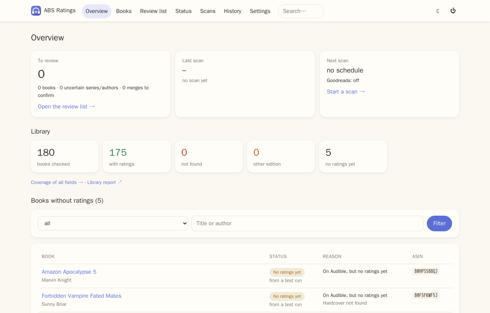
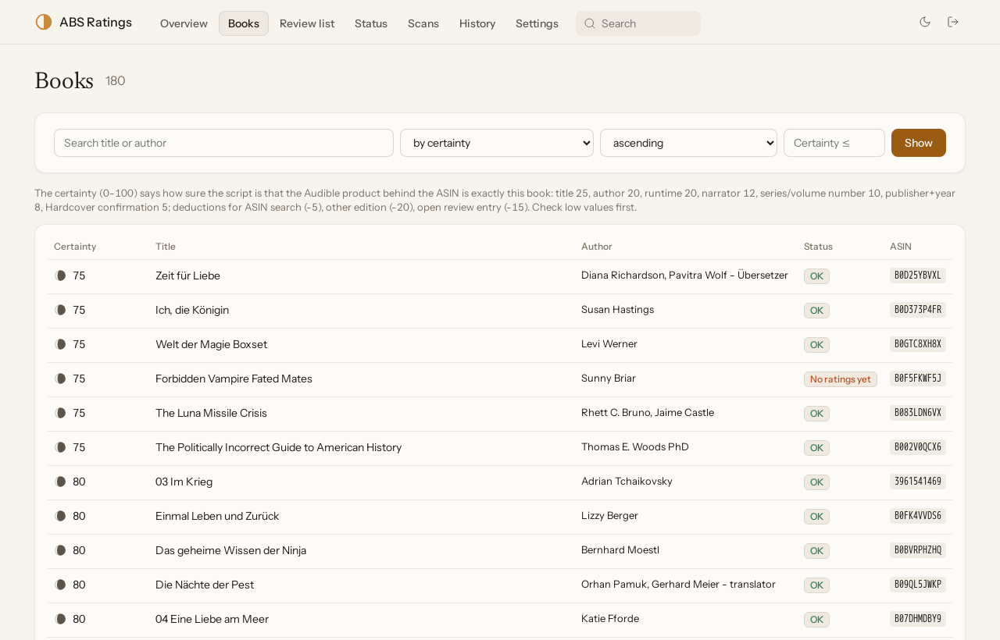
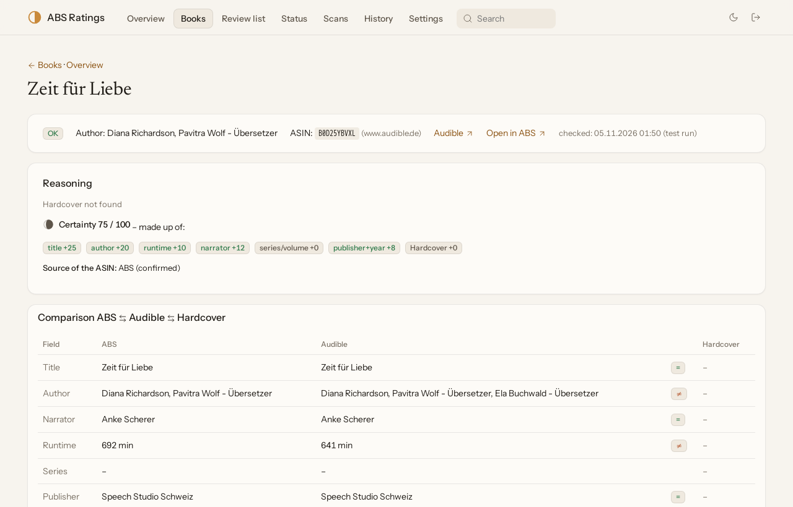
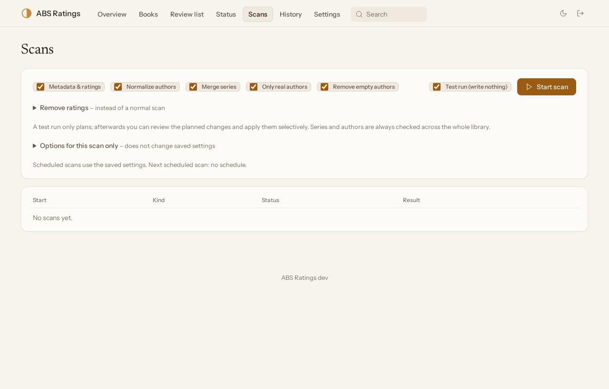
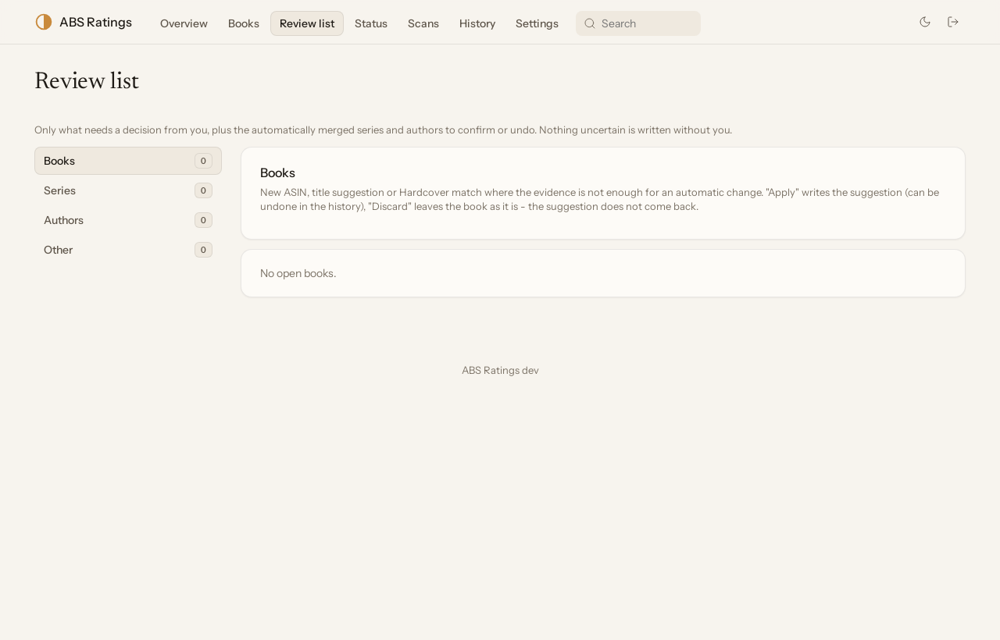
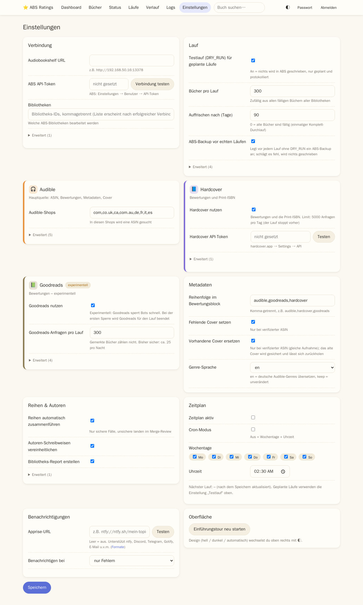

# 🎧 ABS Ratings


> [!WARNING]
> **Use at your own discretion.** This tool writes to your Audiobookshelf library (descriptions, ASINs, series, authors, titles, covers).
> It is a personal project, built and tested on one library. **I do not recommend letting it loose on your Audiobookshelf library.**
> If you try it anyway: make a backup, start with test runs only and review every planned change before you apply anything.

ABS Ratings writes ratings from **Audible** and **Hardcover** (Goodreads experimental) into your audiobook descriptions and keeps the
metadata clean: ASIN repair, series names and numbers, authors, titles, language, covers, ISBN. The guiding rule is **0 wrong matches** -
anything that cannot be verified goes to a review list instead of being written.

## Features

- **Web UI** (English / German): overview with library check, books with match certainty, review list, scans with live progress, settings.
- **Test runs:** plan everything, review it, apply only what you choose. Every real write is journaled and can be undone (field, book or scan).
- **Audible catalog API** (all stores, preferred store per language), verified by title, author, runtime and narrator.
- **Series:** merges duplicate spellings, fixes wrong or shared numbers, removes foreign-language names, adds sub-series Audible confirms.
- **Authors:** unifies spellings, removes role credits (translators, illustrators …), fixes swapped authors/narrators.
- **Hardcover:** ratings and the print ISBN; **Goodreads** optional and experimental (stops at the first bot block).
- **Lock tags** in ABS protect anything you curated yourself.

## Installation (Docker / Unraid)

Image: `ghcr.io/xroguel1ke/abs_ratings` (`:latest` = main), built by GitHub Actions.

```bash
docker run -d --name abs-ratings -p 47823:47823 -v /path/to/data:/config ghcr.io/xroguel1ke/abs_ratings:latest
```

**Unraid:** Docker → Add Container with the template [`unraid/abs-ratings.xml`](unraid/abs-ratings.xml) (port `47823`, `/config` → an appdata folder).

First steps: open `http://<server>:47823`, log in with `admin` (you are asked to change it), enter ABS URL + API token and the libraries
under *Settings → Connection*. Then start a **test run** and review the planned changes.

## Rating block

The block is added at the top (or bottom) of the description and updated in place:

> **⭐ Ratings & Infos**<br>
> Audible (124):<br>
> 🏆 🌕🌕🌕🌕🌗 4.6 / 5 - Overall<br>
> 🎙️ 🌕🌕🌕🌕🌕 4.8 / 5 - Performance<br>
> 📖 🌕🌕🌕🌕🌑 4.2 / 5 - Story<br>
> Hardcover (450):<br>
> 🏆 🌕🌕🌕🌕🌗 4.4 / 5 - Rating<br>
> ⭐

## Lock tags

Add these tags to a book in Audiobookshelf to keep the tool away from a field:

`lock_all` (skip the book completely) · `lock_metadata` (only ratings) · `lock_asin` · `lock_title` · `lock_series` · `lock_authors` ·
`lock_narrators` · `lock_language` · `lock_genres` · `lock_publisher` · `lock_year` · `lock_isbn` · `lock_cover` · `lock_explicit` ·
`lock_abridged` · `lock_description`

## Screenshots

| Overview | Books | Book page |
|---|---|---|
|  |  |  |
| **Scans** | **Review list** | **Settings** |
|  |  |  |

---
<sub>Vibecoded: concept and rules by the developer, built with AI assistance.</sub>
